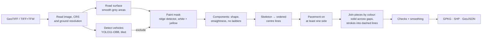

# Aerial Road Markings

Extracts road markings from aerial orthophotos (GeoTIFF) and turns them into
GIS-ready vector lines: solid and dashed markings as separate, measured
features in the coordinate system of the source image.


## Why

Every public road in Russia has a technical passport: an inventory of its
geometry and equipment, kept up to date by the road owner. A central part of
it is the plan of the road as it actually exists, with carriageway edges,
lane lines and other markings drawn in a GIS.

Today the source for that plan is usually an aerial orthophoto taken by a
drone, and the drawing is still done by hand: an engineer traces every
edge line and every dash on the screen, image after image, along hundreds of
kilometres of highway. It is slow, repetitive work, and the result depends on
who did the tracing.

The same approach can potentially be used with lidar surveys (mobile or
airborne laser scanning) as well, provided the point cloud is rasterised into
a GeoTIFF with natural colour grading, so that the paint looks the way it does
on a photo.

I work as a GIS engineer and do this kind of work myself, so I wrote this tool
to take over the repetitive part: it draws the existing markings automatically,
in the coordinate system of the survey, and leaves the engineer to check and
correct the result instead of drawing everything from scratch.

## What it does

- **Input:** an RGB orthophoto, either a GeoTIFF or a plain TIFF with a world file (`.tfw`) and optional `.prj`.
- **Output:** a GeoPackage with the layers `markings`, `segments` and `vehicles`, a zipped Shapefile and GeoJSON.
- **Attributes of every line:** type (`solid` or `dashed`), paint colour (`white` or `yellow`), length in metres, number of joined pieces, mean paint width.
- **Batches:** several orthophotos at once. Each image gets its own results, and all lines are also merged into one layer with an `image` column.
- **Interfaces:** a command-line tool and a web page where you drop one or more images and inspect the lines on a satellite map.

## How it works



1. **Road surface.** Paint only exists on pavement, so the search area is limited first. On a copy downsampled to about 25 cm per pixel, asphalt and concrete are found as colourless and smooth at the scale of a metre; grass, fields and forest are textured or coloured. Morphology fills joints, patches and markings inside the carriageway.
2. **Vehicles.** A white car is indistinguishable from paint by colour. A YOLO oriented-bounding-box model trained on aerial imagery (DOTA) finds cars and trucks, and their footprints are removed. The image is resampled to the model's training resolution and processed in overlapping tiles, so detection works on orthophotos of any size.
3. **Paint mask.** A ridge detector compares every pixel with the points 20–35 cm away on both sides, in eight directions. Paint is brighter than the surface on both sides of it; the bright edge of a concrete slab next to a dark joint or shoulder is not. White and yellow paint are both accepted.
4. **Shape filter.** Each blob is measured in metres: length, width along its axis, elongation and straightness. Paint follows the road smoothly, so even on a bend any 5 m of it deviate from a straight chord by a few centimetres; chains of gravel grains or grass blades meander by decimetres. A guardrail seen from above is two rails joined by posts, a "ladder" full of small enclosed gaps; paint has none.
5. **Centre lines.** Every blob is skeletonised and the skeleton is traced as a graph (longest path first, then long branches), giving ordered polylines.
6. **Surface check.** The ground is sampled 0.5–1.1 m to the left and right of each line. Paint lies on asphalt or concrete, at least on one side (an edge line has pavement on the inside only); debris and kerbs on soil or grass are dropped. The paint colour is taken from the Lab b* channel along the axis.
7. **Joining.** Pieces of the same colour are chained end to end when the gap is short, the directions match and the next piece lies on the continuation of the current one. Solid lines are restored across shadows and worn paint; strokes become one dashed line, even when a car or a shadow hides one of them.
8. **Checks and smoothing.** A dashed line needs at least four strokes, a length of 25 m or more and a steady rhythm of strokes and gaps. Short pieces must be parallel to the nearest long solid line, which removes poles and their shadows. Final lines are smoothed with a 4 m moving average, which removes pixel jitter but keeps highway bends.

All thresholds are set in metres (`src/aerial_markings/config.py`) and converted with the image's ground resolution, so the same settings work for 3 cm and 15 cm imagery.

## Quick start

```bash
git clone https://github.com/faithfoolness/AerialPhotographyProcessing.git
cd AerialPhotographyProcessing
python -m venv .venv
.venv\Scripts\activate             # Windows  (Linux/macOS: source .venv/bin/activate)
pip install -e .[vehicles]         # without [vehicles] the YOLO step is skipped
```

Try it on a generated test image:

```bash
aerial-markings demo -o data/synthetic_road.tif
aerial-markings extract data/synthetic_road.tif -o results/
```

```
synthetic_road.tif: 6 lines in 5.1 s -> results
  dashed     2 lines      269.8 m
  solid      4 lines      583.5 m
  files: synthetic_road_markings.gpkg, synthetic_road_markings_shp.zip, synthetic_road_markings.geojson, stats.json
```

Web interface:

```bash
aerial-markings serve            # then open http://127.0.0.1:8000
```

Your own imagery:

```bash
aerial-markings extract photos/*.tif -o results/    # results/<image>/... plus results/all_markings.*
aerial-markings extract tile.tif --crs EPSG:32637   # if the image carries no CRS
```

In the web interface, drop files or a whole folder (or pick them with "Choose files" / "Choose folder"); `.tfw` and `.prj` are matched to images by file name. Images are processed one after another, and a failure in one does not stop the rest.

The YOLO weights (`yolo11n-obb.pt`, 5.5 MB) download automatically on first run.

## Project structure

```
src/aerial_markings/
  raster.py      reading GeoTIFF / TIFF+TFW, CRS resolution, ground resolution
  vehicles.py    tiled YOLO-OBB vehicle detection
  road.py        road surface mask
  mask.py        paint mask (ridge detector, white/yellow, vegetation filter)
  surface.py     pavement check beside each line
  vectorize.py   components, shape filter, skeleton tracing
  merge.py       chaining pieces into solid and dashed lines
  pipeline.py    the end-to-end run with timings and statistics
  export.py      GeoPackage, Shapefile, GeoJSON, web preview
  cli.py         command-line interface
  web/           FastAPI app and the map page (Leaflet)
  synthetic.py   synthetic test scene
tests/           pytest: pipeline, CRS handling, web API
```

```bash
pip install -e .[dev]
pytest
```

## Project history

The first version was a prototype that stored every white pixel in PostgreSQL
and grouped pixels with a breadth-first search in Python. It worked, but it
had three problems: about 13 minutes per image, zig-zag lines, and noise from
trees and white cars. Version 2 is a rewrite of the processing core:

| | v1 (prototype) | v2 |
|---|---|---|
| Pixel grouping | BFS over a database table, ~12 min | in-memory connected components, < 1 s |
| Paint detection | fixed threshold R, G, B > 200 | ridge detector (brighter than both sides), white and yellow |
| Noise from trees and grass | many false lines | search limited to the road surface, shape and rhythm checks |
| Vehicles | COCO model on the whole image shrunk to 640 px, found nothing | aerial OBB model on native-scale tiles |
| Line geometry | skeleton pixels joined row by row, zig-zags | skeleton traced as a graph, then smoothed |
| Guardrails | detected as markings | rejected by shape (ladder of rails and posts) |
| CRS | always labelled EPSG:4326 | read from the image or given explicitly |
| Dependencies | PostgreSQL server required | none besides Python packages |

## Limitations

- Designed for nadir RGB orthophotos with a resolution of about 2–15 cm per pixel.
- Pedestrian crossings, arrows and other symbols are not classified yet. Their pieces are kept in the `segments` layer, and recognising them is a natural next step.
- The road surface detector expects grey asphalt. Very light concrete or snow-covered shoulders may need different thresholds (`RoadParams` in `config.py`).
- The vehicle model is generic. Fine-tuning it on local imagery would improve recall for dark and partially occluded vehicles.

## License

MIT
